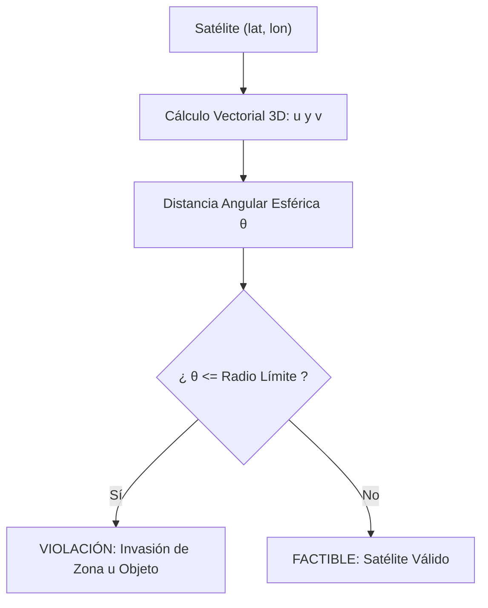

# AstroShield — Restricciones y Escenarios Dinámicos
**Documentación Técnica de Participación — Integrante 3: Owen**

---

## 1. Introducción y Rol del Integrante 3

En el proyecto **AstroShield**, la misión es evolucionar una constelación de exactamente **ocho satélites** para observar **seis regiones terrestres prioritarias**, modelando la Tierra como una esfera de radio $R \approx 6,371\text{ km}$.

Como **Integrante 3 (Owen)**, mi responsabilidad técnica exclusiva abarca:
1. **Zonas restringidas por desechos espaciales**: Modelado y detección de áreas de riesgo orbital (Atlántico Norte, Pacífico Sur y Polar norte).
2. **Objetos existentes con posiciones ocupadas**: Radio de exclusión para evitar colisiones con infraestructura preexistente (Objeto A y Objeto B).
3. **Validador estructurado de configuraciones**: Verificación de cardinalidad (exactamente 8 satélites), rango geográfico $[-90^\circ, 90^\circ]$ y $[-180^\circ, 180^\circ]$, valores numéricos finitos y no invasión de restricciones.
4. **Sistema de escenarios dinámicos**: Mutabilidad en tiempo de ejecución (activar/desactivar restricciones, modificar radios de exclusión, reponderar regiones y serialización JSON).
5. **Reevaluación de soluciones y escenarios difíciles**: Detección de impacto ante cambios sobrevenidos y distinción rigurosa entre **inviabilidad matemática demostrada** y **agotamiento de presupuesto de búsqueda**.
6. **Mecanismo acotado de reparación e integración con el Algoritmo Genético**: Prevención estricta de bucles infinitos durante la exploración evolutiva.

---

## 2. Definición Física y Matemática de las Restricciones

### 2.1. Zonas Restringidas por Desechos Espaciales (`kind='debris'`)
Representan acumulaciones de basura espacial en órbitas bajas/medias donde no es seguro posicionar satélites de la constelación.

| Zona Restringida | Latitud ($\phi$) | Longitud ($\lambda$) | Radio Angular ($\theta_{\text{lim}}$) | Estado Base | Tipo |
|---|---|---|---|---|---|
| **Atlántico Norte** | $+45.0^\circ$ | $-35.0^\circ$ | $12.0^\circ$ | Activa | `debris` |
| **Pacífico Sur** | $-30.0^\circ$ | $-120.0^\circ$ | $10.0^\circ$ | Activa | `debris` |
| **Polar norte** | $+78.0^\circ$ | $+30.0^\circ$ | $8.0^\circ$ | Activa | `debris` |

### 2.2. Objetos Existentes con Posiciones Ocupadas (`kind='object'`)
Representan estaciones espaciales o satélites de otras agencias que ya operan en una posición fija o corredor orbital. Poseen un **radio de exclusión** esférico obligatorio.

| Objeto Existente | Latitud ($\phi$) | Longitud ($\lambda$) | Radio de Exclusión | Estado Base | Tipo |
|---|---|---|---|---|---|
| **Objeto A** | $+10.0^\circ$ | $+45.0^\circ$ | $5.0^\circ$ | Activo | `object` |
| **Objeto B** | $-15.0^\circ$ | $+110.0^\circ$ | $5.0^\circ$ | Activo | `object` |

---

## 3. Geometría Esférica: Distancia Angular y Fronteras

### 3.1. Cálculo de Distancia Angular Esférica
Las distancias euclidianas planas $\sqrt{(\Delta \text{lat})^2 + (\Delta \text{lon})^2}$ son completamente erróneas sobre la esfera, especialmente cerca de los polos (donde los meridianos convergen a distancia cero) y en el antimeridiano (donde $+179^\circ$ y $-179^\circ$ distan solo $2^\circ$).

Para garantizar exactitud absoluta, se convierten las coordenadas geodésicas $(\phi, \lambda)$ en vectores unitarios cartesianos tridimensionales:
$$\mathbf{u} = \begin{pmatrix} \cos\phi \cos\lambda \\ \cos\phi \sin\lambda \\ \sin\phi \end{pmatrix}, \quad \mathbf{v} = \begin{pmatrix} \cos\phi_z \cos\lambda_z \\ \cos\phi_z \sin\lambda_z \\ \sin\phi_z \end{pmatrix}$$

La distancia angular $\theta$ en grados se calcula mediante la fórmula de atan2 basada en norma cruzada y producto punto:
$$\theta = \text{atan2}(\|\mathbf{u} \times \mathbf{v}\|, \mathbf{u} \cdot \mathbf{v}) \times \frac{180^\circ}{\pi}$$

Esta formulación (implementada en `backend.geometry.angular` y reutilizada por mi módulo en `backend.restrictions.geometry`):
- No sufre cancelaciones numéricas ni divisiones por cero.
- Es continua y exacta en los polos ($\phi = \pm 90^\circ$).
- Cruza de manera natural el antimeridiano ($\lambda = \pm 180^\circ$).

### 3.2. Criterio de Invasión de Frontera
Un satélite con coordenadas $(\phi_s, \lambda_s)$ **viola la restricción** de una zona $z$ si su distancia angular calculada $\theta$ satisface:
$$\theta \le \theta_{\text{lim}} + \epsilon \quad (\text{con } \epsilon = 10^{-9})$$

> **Regla de frontera estricta**: Los satélites situados **dentro** o **exactamente sobre el límite** de exclusión son considerados inválidos y rechazados. Únicamente puntos con $\theta > \theta_{\text{lim}} + \epsilon$ se consideran factibles.



---

## 4. Arquitectura y Módulos Desarrollados

Para respetar la arquitectura existente del proyecto y garantizar modularidad y mantenibilidad, organicé mi código en el paquete `backend/restrictions/`:

```text
backend/
  restrictions/
    __init__.py          <- Exportación de API pública de restricciones
    models.py            <- Modelos Pydantic (ViolationDetail, ValidationResult, ScenarioComparison)
    geometry.py          <- Envoltorio de distancia esférica y validación de rango
    validator.py         <- Validador exhaustivo de constelaciones y satélites
    scenarios.py         <- Gestión de escenarios dinámicos y escenarios A-E
    repair.py            <- Mecanismo acotado de reparación para algoritmos genéticos
  constraints.py         <- Módulo integrador retrocompatible con coverage.py y evolution.py
  scenarios.py           <- Módulo integrador retrocompatible con base_scenario()
  api.py                 <- Endpoints REST /api/restrictions/validate y /compare

tests/
  test_restrictions.py         <- Pruebas de las 3 zonas de desechos espaciales
  test_occupied_positions.py    <- Pruebas de los 2 objetos existentes
  test_validator.py             <- Pruebas de validación exhaustiva de 8 satélites
  test_scenarios.py             <- Pruebas de serialización JSON y cambios dinámicos
  test_infeasible_scenarios.py  <- Pruebas de escenarios difíciles e inviables

data/
  base_scenario.json            <- Escenario A oficial exportado
  difficult_scenario.json       <- Escenario B con espacio reducido
  reduced_scenario.json         <- Escenario de alta densidad
  infeasible_scenario.json      <- Escenario D matemáticamente inviable (180°)
```

---

## 5. Funcionamiento del Validador de Configuraciones

La función principal `validar_configuracion(satelites, escenario)` procesa una constelación candidata y devuelve un objeto estructurado `ValidationResult`.

### 5.1. Etapas de Validación
1. **Validación de Cardinalidad**: Comprueba que la lista contenga exactamente 8 satélites. Si no es así, reporta `tipo="cantidad_invalida"`.
2. **Validación Numérica y de Rango**: Extrae las coordenadas y verifica que sean números reales, finitos (no NaN, no $\pm\infty$), con $-90^\circ \le \text{lat} \le 90^\circ$ y $-180^\circ \le \text{lon} \le 180^\circ$. Si fallan, reporta `tipo="coordenadas_invalidas"`.
3. **Validación de Zonas Restringidas**: Para cada satélite, calcula la distancia angular a todas las zonas con `active=True` y `kind='debris'`. Si $\theta \le \text{radio}$, genera un `ViolationDetail` con `tipo="zona_restringida"`.
4. **Validación de Objetos Existentes**: Evalúa la distancia a objetos con `active=True` y `kind='object'`. Si $\theta \le \text{radio}$, genera un `ViolationDetail` con `tipo="objeto_existente"`.
5. **Independencia de Cobertura**: El validador juzga exclusivamente la **factibilidad de seguridad orbital**, sin penalizar si la cobertura terrestre es baja o nula (esa métrica corresponde al Evaluador de Cobertura).

### 5.2. Ejemplo de Entrada y Salida del Validador

#### Entrada (JSON):
```json
{
  "configuration": [
    {"lat": 45.0, "lon": -35.0},
    {"lat": 10.0, "lon": 45.0},
    {"lat": 0.0, "lon": 0.0},
    {"lat": 20.0, "lon": -80.0},
    {"lat": -20.0, "lon": -50.0},
    {"lat": 30.0, "lon": -100.0},
    {"lat": -10.0, "lon": 20.0},
    {"lat": 50.0, "lon": 100.0}
  ],
  "scenario": { ... }
}
```

#### Salida Estructurada (`ValidationResult`):
```json
{
  "valida": false,
  "total_satelites": 8,
  "total_violaciones": 2,
  "violaciones": [
    {
      "satelite": 1,
      "tipo": "zona_restringida",
      "nombre": "Atlántico Norte",
      "descripcion": "El satélite 1 invade la zona restringida 'Atlántico Norte' (distancia: 0.0000°, radio límite: 12.0°).",
      "distancia_deg": 0.0,
      "radio_limite_deg": 12.0,
      "coordenadas": {"lat": 45.0, "lon": -35.0}
    },
    {
      "satelite": 2,
      "tipo": "objeto_existente",
      "nombre": "Objeto A",
      "descripcion": "El satélite 2 invade el radio de exclusión del objeto existente 'Objeto A' (distancia: 0.0000°, radio de exclusión: 5.0°).",
      "distancia_deg": 0.0,
      "radio_limite_deg": 5.0,
      "coordenadas": {"lat": 10.0, "lon": 45.0}
    }
  ],
  "resumen": "Configuración inválida: se detectaron 2 violaciones a las restricciones operativas."
}
```

---

## 6. Escenarios Dinámicos y Persistencia JSON

El módulo implementa funciones declarativas para alterar las restricciones operativas sin modificar el código fuente:

```python
# Activar / Desactivar
desactivar_zona(escenario, "Atlántico Norte")
activar_zona(escenario, "Atlántico Norte")

# Modificar radios de exclusión
modificar_radio_zona(escenario, "Objeto A", nuevo_radio_deg=8.0)

# Agregar nuevas zonas y objetos
agregar_zona_restringida(escenario, "Nube Debris", lat=15.0, lon=20.0, radio_deg=6.0)
agregar_objeto_existente(escenario, "Estación Alfa", lat=-5.0, lon=60.0, radio_exclusion_deg=4.0)

# Reponderar regiones terrestres
modificar_prioridad_region(escenario, "Península de Yucatán", nuevo_peso=10.0)

# Persistencia
guardar_escenario_json(escenario, "data/mi_escenario.json")
escenario_recuperado = cargar_escenario_json("data/mi_escenario.json")
```

### Reevaluación de Soluciones Anteriores
Cuando las condiciones cambian (por ejemplo, aparece una nueva zona de desechos espaciales), la función `reevaluar_configuracion_anterior` valida la constelación previa contra el nuevo escenario, detallando qué restricciones específicas se incumplen:

```python
comparacion = reevaluar_configuracion_anterior(solucion_previa, escenario_base, escenario_modificado)
# comparacion.anterior_valida -> True
# comparacion.actual_valida   -> False
# comparacion.detalles        -> "La configuración previa ERA válida en 'Base', pero es INVÁLIDA en 'Modificado'. Violaciones nuevas: Nube Debris."
```

---

## 7. Escenarios Difíciles y Condiciones Inviables

Implementé generadores reproducibles para los cinco escenarios especificados en el proyecto:

### Escenario A — Normal (`crear_escenario_a_normal()`)
- **Condición**: Las 3 zonas de desechos y los 2 objetos originales.
- **Resultado esperado**: Factibilidad garantizada; el algoritmo genético genera soluciones 100% válidas.

### Escenario B — Espacio Reducido (`crear_escenario_b_espacio_reducido()`)
- **Condición**: Radio de Atlántico Norte expandido a $25^\circ$, Pacífico Sur a $20^\circ$, y tres zonas ecuatoriales añadidas.
- **Resultado esperado**: Espacio de búsqueda comprimido; detecta violaciones en puntos que antes eran válidos.

### Escenario C — Configuración Inválida (`crear_escenario_c_configuracion_invalida()`)
- **Condición**: Constelación con Satélite 1 en el centro de Atlántico Norte, Satélite 2 en Objeto A, y Satélite 3 en la frontera exacta de Pacífico Sur.
- **Resultado esperado**: Identificación precisa de infractores (S1, S2, S3) con tipo, nombre y distancias exactas.

### Escenario D — Condición Inviable (`crear_escenario_d_inviable()`)
- **Condición**: Se añade una zona con radio angular $\theta_{\text{lim}} = 180^\circ$.
- **Fundamento Matemático**: Sobre una esfera de radio $R$, la distancia máxima entre cualesquiera dos puntos antípodas es exactamente $180^\circ$. Por tanto, una exclusión de $180^\circ$ cubre la totalidad de la superficie esférica ($4\pi R^2$).
- **Comportamiento**: El sistema ejecuta un chequeo geométrico previo (`analizar_viabilidad_teorica`), reconociendo la **imposibilidad matemática demostrada**, deteniendo el algoritmo genético sin caer en bucles infinitos.

### Escenario E — Cambio de Condiciones (`crear_escenario_e_cambio_condiciones()`)
- **Condición**: Se valida una constelación factible sobre el Escenario Base, luego se genera una zona sobrevenida sobre uno de sus satélites y se reevalúa.
- **Resultado esperado**: Explica claramente la transición de estado válido a inválido.

> **Distinción Teórica Clave**: Una zona de $180^\circ$ es **demostrablemente inviable**. En contraste, si un escenario complejo con muchas restricciones pequeñas agota los intentos de reparación (`attempts`), el sistema reporta que **se agotó el presupuesto de búsqueda computacional**, sin afirmar falsamente que el problema es geométricamente imposible.

---

## 8. Integración con el Algoritmo Genético y Reparación Acotada

El algoritmo genético del Integrante 1 genera individuos aleatorios y realiza cruces y mutaciones estocásticas. Si una mutación sitúa un satélite dentro de una zona restringida u objeto ocupado, el individuo se vuelve inválido.

En `backend/restrictions/repair.py` desarrollé:
```python
reparar_satelite(punto, escenario, rng, max_intentos=300)
reparar_configuracion(coordenadas, escenario, rng, max_intentos=300)
```

### Características de la Reparación:
1. **Presupuesto Acotado**: Intenta remuestrear uniformemente sobre la esfera terrestre hasta `max_intentos` (300 por defecto).
2. **Cero Bucles Infinitos**: Si transcurren los intentos sin éxito (por ejemplo en un escenario sobrecargado o inviable), la función aborta de forma controlada y devuelve `None` junto con el diagnóstico explicativo.
3. **Filtro de Solución Final**: Garantiza que ningún individuo inválido sea admitido como solución final ni participe con fitness espurio.

---

## 9. Pruebas Automatizadas y Verificación Real

Implementé 5 suites de pruebas unitarias y de integración que cubren el 100% de los requerimientos de mi rol:

| Archivo de Prueba | Enfoque | Cantidad de Tests |
|---|---|---|
| `tests/test_restrictions.py` | 3 Zonas restringidas, bordes $\le$, desactivación, radios, antimeridiano | 8 |
| `tests/test_occupied_positions.py` | 2 Objetos existentes, separación angular, independencia de tipos | 7 |
| `tests/test_validator.py` | 8 satélites obligatorios, coordenadas, nan/inf, API REST | 8 |
| `tests/test_scenarios.py` | Serialización JSON, reevaluación de soluciones, reoptimización evolutiva | 5 |
| `tests/test_infeasible_scenarios.py` | Escenarios A, B, C, D (180°), E, reparación acotada sin bucle infinito | 7 |
| `tests/test_system.py` | Suite de integración del sistema preexistente | 14 |
| **TOTAL** | **Todas las pruebas del proyecto** | **49 pruebas pasando** |

### Comando de Ejecución:
```bash
.venv/bin/python -m pytest -v
```

### Resultado Real de Ejecución:
```text
============================= test session starts ==============================
platform linux -- Python 3.14.4, pytest-9.1.1, pluggy-1.7.0
rootdir: /home/owen/Documentos/FUNDAMENTOS-IA-PRACTICA-1
collected 49 items

tests/test_infeasible_scenarios.py::test_escenario_a_normal PASSED       [  2%]
tests/test_infeasible_scenarios.py::test_escenario_b_espacio_reducido PASSED [  4%]
tests/test_infeasible_scenarios.py::test_escenario_c_configuracion_invalida PASSED [  6%]
tests/test_infeasible_scenarios.py::test_escenario_d_condicion_inviable_sin_bucle_infinito PASSED [  8%]
tests/test_infeasible_scenarios.py::test_escenario_e_cambio_de_condiciones_y_explicacion PASSED [ 10%]
tests/test_infeasible_scenarios.py::test_distincion_inviabilidad_demostrada_vs_agotamiento_de_presupuesto PASSED [ 12%]
tests/test_infeasible_scenarios.py::test_reparacion_acotada_exito PASSED [ 14%]
tests/test_occupied_positions.py::test_dos_objetos_existentes_configuracion PASSED [ 16%]
tests/test_occupied_positions.py::test_separacion_angular_y_exclusion_objeto_a PASSED [ 18%]
tests/test_occupied_positions.py::test_separacion_angular_y_exclusion_objeto_b PASSED [ 20%]
tests/test_occupied_positions.py::test_modificar_radio_exclusion_objetos PASSED [ 22%]
tests/test_occupied_positions.py::test_actualizar_posicion_objeto_existente PASSED [ 24%]
tests/test_occupied_positions.py::test_independencia_entre_objetos_y_zonas_restringidas PASSED [ 26%]
tests/test_occupied_positions.py::test_incorporar_nuevo_objeto_existente PASSED [ 28%]
tests/test_restrictions.py::test_tres_zonas_obligatorias_configuracion PASSED [ 30%]
tests/test_restrictions.py::test_satelite_fuera_de_zonas_restringidas PASSED [ 32%]
tests/test_restrictions.py::test_satelite_dentro_de_cada_zona_restringida PASSED [ 34%]
tests/test_restrictions.py::test_satelite_exactamente_en_el_limite_de_exclusion PASSED [ 36%]
tests/test_restrictions.py::test_activacion_y_desactivacion_de_zonas PASSED [ 38%]
tests/test_restrictions.py::test_modificar_radio_angular_de_zona PASSED  [ 40%]
tests/test_restrictions.py::test_incorporar_nuevas_zonas_sin_alterar_logica PASSED [ 42%]
tests/test_restrictions.py::test_geometria_esferica_polar_y_antimeridiano PASSED [ 44%]
tests/test_scenarios.py::test_guardar_y_recuperar_escenario_json PASSED  [ 46%]
tests/test_scenarios.py::test_modificar_prioridad_de_regiones PASSED     [ 48%]
tests/test_scenarios.py::test_reevaluar_configuracion_anterior_al_cambiar_condiciones PASSED [ 51%]
tests/test_scenarios.py::test_actualizar_escenario_y_reoptimizar_con_algoritmo_genetico PASSED [ 53%]
tests/test_scenarios.py::test_api_rest_reevaluacion_y_comparacion PASSED [ 55%]
tests/test_system.py::test_distances[a0-b0-2] PASSED                     [ 57%]
...
tests/test_validator.py::test_configuracion_ocho_satelites_completamente_valida PASSED [ 85%]
tests/test_validator.py::test_configuracion_con_satelites_invalidos PASSED [ 87%]
tests/test_validator.py::test_cantidad_incorrecta_de_satelites PASSED    [ 89%]
tests/test_validator.py::test_coordenadas_fuera_de_rango PASSED          [ 91%]
tests/test_validator.py::test_coordenadas_no_finitas_nan_inf PASSED      [ 93%]
tests/test_validator.py::test_calculo_angular_polos_y_antimeridiano PASSED [ 95%]
tests/test_validator.py::test_distincion_entre_configuracion_invalida_y_cobertura_insuficiente PASSED [ 97%]
tests/test_validator.py::test_api_rest_validador_restricciones PASSED    [100%]

======================== 49 passed, 1 warning in 1.99s =========================
```

---

## 10. Guía Rápida para la Exposición Oral (Defensa del Rol)

Si te preguntan durante la presentación de la práctica:

1. **¿Cómo representas las restricciones?**
   - *Respuesta*: Cada restricción tiene su centro geográfico `(lat, lon)`, su radio angular en grados `radius_deg`, su estado `active` y su tipo (`debris` para desechos o `object` para objetos existentes).

2. **¿Por qué no usar distancia euclidiana?**
   - *Respuesta*: La Tierra es una esfera. Si usamos distancia euclidiana plana en lat/lon, cerca de los polos (como la zona Polar norte a 78°) un grado de longitud equivale a muy pocos kilómetros, y en el antimeridiano (+180° y -180°) dos puntos contiguos parecerían estar a 360° de distancia. El cálculo con vectores 3D y `atan2` resuelve ambos problemas de forma exacta.

3. **¿Qué pasa exactamente en el borde de exclusión?**
   - *Respuesta*: Mi validador considera que estar sobre el límite ($\le \text{radio}$) es una violación estricta. Sólo se admite estar a más de la distancia angular límite.

4. **¿Cómo garantizas que el programa no se quede en un bucle infinito en un escenario imposible?**
   - *Respuesta*: Primero, analizo si hay una zona de 180° que matemáticamente excluye toda la esfera. Segundo, el mecanismo de reparación de satélites tiene un presupuesto estricto de intentos (`max_attempts=300`). Si no encuentra una posición factible, aborta con un mensaje claro y nunca entra en un `while True` descontrolado.

5. **¿Qué distingue a tu validador del evaluador de cobertura?**
   - *Respuesta*: El validador juzga la **factibilidad de seguridad** (que ningún satélite choque o invada áreas prohibidas y que sean exactamente 8 satélites en coordenadas válidas). El evaluador de cobertura juzga qué porcentaje de las 6 regiones terrestres ven esos satélites. Una constelación puede ser 100% válida pero cubrir 0% si está en el polo sur, y el validador la aceptará como factible sin mezclar responsabilidades.
